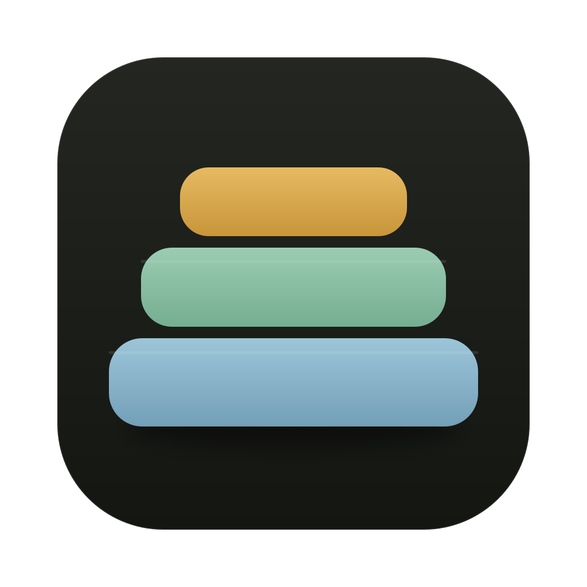
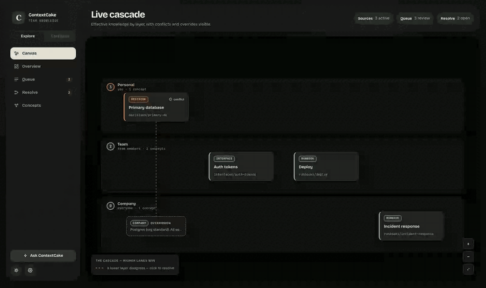

<p align="center">
  <a href="https://contextcake.com">
    
  </a>
</p>

<h1 align="center">ContextCake</h1>

<p align="center">
  <strong>Project context for AI tools, with its sources, dates and disagreements intact.</strong>
</p>

<p align="center">
  <a href="https://github.com/ContextCake/context-cake/actions/workflows/ci.yml"></a>
  <a href="https://nodejs.org/"></a>
  <a href="LICENSE"></a>
  <a href="https://modelcontextprotocol.io/"></a>
</p>

<p align="center">
  <a href="https://github.com/ContextCake/context-cake/releases/latest">Download app</a> ·
  <a href="https://contextcake.com">Website</a> ·
  <a href="https://contextcake.com/demo">Live demo</a> ·
  <a href="https://contextcake.com/docs">Documentation</a>
</p>

<p align="center">
  
</p>

Teams don't have one source of truth. They have a company policy, a team decision, a runbook and the personal note that explains the exception. Flatten those into one wiki and you lose both the detail and the disagreement. ContextCake keeps each scope in its own source and resolves them when an agent asks, so the answer comes back with where each part came from, how old it is, and who disagrees.

## How it resolves

```text
Personal · level 3   drafts, notes, local overrides
Team     · level 2   runbooks, decisions, system docs
Company  · level 0   organization-wide knowledge
                ↓ resolved section by section at read time
        one sourced answer, with dissent and dates attached
```

```text
decisions/primary-db
  Engine   → SingleStore                  (team, updated 2026-05-12)
             company says Postgres        (company, updated 2026-06-01, newer)
  Backups  → Nightly snapshots            (inherited from company)
```

A team can override the database engine and still inherit the company backup policy. The higher layer wins each section, and the losing value stays visible with its date.

## Quick start

```bash
git clone https://github.com/ContextCake/context-cake.git && cd context-cake
node resolver.mjs --manifest apps/playground/manifest.json --concept decisions/primary-db
npm run playground   # visual explorer at http://127.0.0.1:8790
```

Needs Node 22+. The source checkout needs no npm install: the core uses only Node built-ins. Configured remote sources may use the network. The [signed Mac app and Linux package](https://github.com/ContextCake/context-cake/releases/latest) walk you through adding sources and connecting an AI client. For the standalone npm CLI, use the [current installation instructions](https://contextcake.com/install/).

## Connect an agent

```bash
claude mcp add contextcake -- node /ABSOLUTE/PATH/context-cake/mcp-server.mjs \
  --manifest /ABSOLUTE/PATH/context-cake/apps/playground/manifest.json
```

Agents get read tools (`search`, `read_file`, `list_concepts`, `get_links`, `find_captures`, `whats_new`). With `--capture`, they can also stage notes that a person approves before they're shared. See the [MCP tools reference](https://contextcake.com/docs/reference/mcp-tools).

> [!CAUTION]
> A manifest is a trust boundary. An `mcp` source can start the command it names with your user privileges. Only run manifests you trust. See the [trust-boundary guide](https://contextcake.com/docs/concepts/trust-boundary).

## Sources

| Kind | What becomes a layer |
| --- | --- |
| `files` | Any folder of Markdown or text: repo docs, an Obsidian vault, a wiki export |
| `github` | A GitHub repo read over the API, no clone: `CLAUDE.md`, `AGENTS.md`, `README.md`, `docs/**` |
| `okf-local` | A local [OKF](https://github.com/GoogleCloudPlatform/knowledge-catalog/blob/main/okf/SPEC.md) bundle with typed, dated frontmatter |
| `mcp` | A trusted foreign MCP graph, translated into the same view |

## Design decisions

- **Storage stays separate; reading is unified.** Each layer keeps its own source and permissions: repository membership for Git-backed layers, filesystem permissions for folders, and provider permissions for remote sources. No central graph database or per-node permission system.
- **Resolve sections, not documents.** Replacing whole documents forces a team to copy every company policy it doesn't disagree with. Resolving by section lets it override only what it means to.
- **Show disagreement instead of hiding it.** The first design merged silently and tracked staleness with content hashes and a shadow-detection subsystem. In June 2026 I cut all of that. Now each conflicting section carries the other layers' values and their last-updated dates, and a reader can see at a glance when the company version is newer than the team override. Authored `updated` dates still rely on authors keeping them accurate; git-backed sources without them use author history. If that turns out to bite, the fix is a read-time content fingerprint, kept as an alert and never as a resolution rule. [Design notes](specs/contextcake-core/design.md).
- **A dependency-free core.** The resolver, adapters and MCP server ship with no npm dependencies, so the part with access to your knowledge has no runtime npm dependency tree to install. Its vendored tokenizer assets still belong in the supply-chain review.

## Repo layout

| Path | What it is |
| --- | --- |
| `packages/core/` | Resolver, source adapters, MCP server and write path ([architecture](docs/architecture/README.md)) |
| `apps/playground/` | Local explorer for a cascade |
| `apps/console/` | React console for inspecting a resolved graph |
| `apps/desktop/` | Mac and Linux apps around the same engine, with native diagnostics and optional local Grafana on Mac |
| `apps/site/` | Website and [documentation](https://contextcake.com/docs) |

Run `npm test` for the core. [CONTRIBUTING.md](CONTRIBUTING.md) has the checks for each app.

## More

- [Concepts](https://contextcake.com/docs/concepts/layer-cake): layers, merge rules, provenance, conflicts
- [Capture and promotion](https://contextcake.com/docs/guides/capture-write-path): turning repo activity into reviewed knowledge
- [Team sync](examples/team-sync-pack/README.md): a shared live layer for agent captures
- [Threat model](docs/security/threat-model.md) and [network egress](docs/security/egress-allowlist.md)

## Contributing

Read [CONTRIBUTING.md](CONTRIBUTING.md), keep `packages/core/` dependency-free, and sign off commits with `git commit -s` ([DCO](DCO), no CLA). Report security issues through [private vulnerability reporting](https://github.com/ContextCake/context-cake/security/advisories/new).

## License

[MIT](LICENSE)
